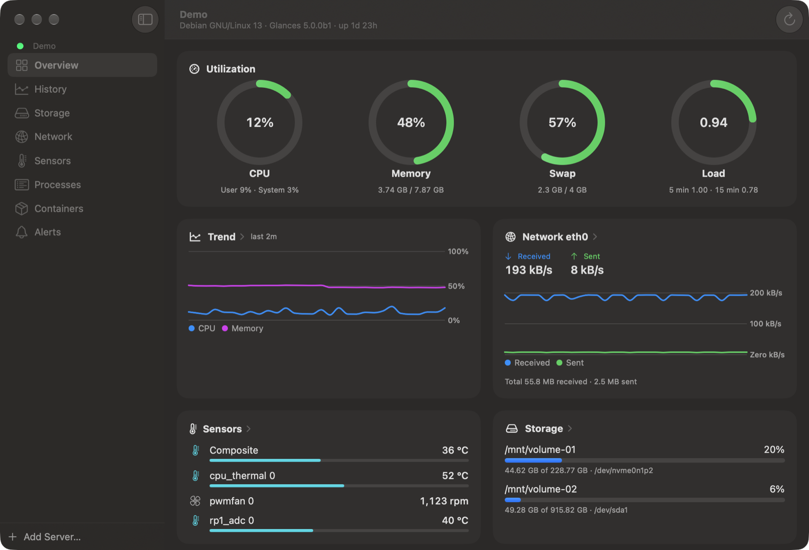
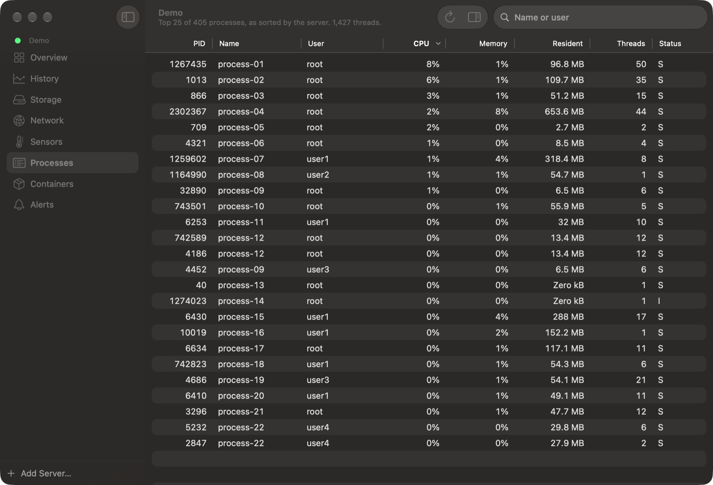

# MetriBar

[](https://github.com/schnabstar/MetriBar/actions/workflows/ci.yml)

**Glances 5 in your macOS menu bar.**

MetriBar is a native macOS menu bar app with a dashboard window for servers running [Glances](https://github.com/nicolargo/glances) 5. See the status of your Raspberry Pi, NAS or Docker host at a glance, and open a native dashboard for the details.

No agent to install, no cloud, no account, no telemetry.



> **Status: preview.** MetriBar uses the Glances 5 REST API (`/api/5`), which is currently in beta. Glances 4 is not supported. Expect changes until Glances 5.0 and MetriBar 1.0 are released.

## Features

- **Menu bar:** one icon for the combined status of all servers; its shape changes on warnings, critical values or when a server is offline. Optionally shows the CPU or memory usage of a server.
- **Popover:** CPU, memory, load, uptime and containers of the selected server, with a server switcher. When a server cannot be read, MetriBar explains why and offers the fix.
- **Dashboard window** with the sections of every server in the sidebar (⌘1–⌘8):
  - Overview with usage rings, trend, network, sensors (temperatures, fans), storage, containers, system information and active alerts
  - History charts from the history Glances keeps
  - File systems and disk I/O
  - Network interfaces
  - Sensors and GPU
  - Processes with search, sorting and an inspector; command lines only on request
  - Containers with CPU and memory limits, network, I/O, uptime and ports
  - Glances alerts and incidents
- **Multiple servers**, each polled independently. Only the data that is visible is fetched.
- **Secure by default:** passwords in the Keychain, TLS validation with optional pinning of self-signed certificates, warnings for passwords over plain HTTP, strictly read-only access.
- **Helpful diagnostics:** a step-by-step connection test, detection of a missing local network permission, and copyable diagnostic details without secrets.
- English and German.



The screenshots show the built-in demo data, not a real server.

## Requirements

- macOS 26 or later, on Apple silicon or Intel (the app is universal)
- A server running **Glances 5** as a web server (`glances -s`). See [Setting up Glances 5](Docs/glances-setup.md).

## Installation

1. Download the disk image (`MetriBar-<version>.dmg`) from the [latest release](https://github.com/schnabstar/MetriBar/releases). While MetriBar is in preview, releases are marked *Pre-release*, so GitHub does not show them as "Latest": open the newest entry in the list.
2. Open the disk image and drag **MetriBar** to your Applications folder.

The app is signed with a Developer ID and notarized by Apple. Each release also lists a SHA-256 checksum (`MetriBar-<version>.sha256`) if you want to verify the download.

To try MetriBar without a server, choose **Try with Demo Data** after the first launch.

### Updating

MetriBar has no automatic updater and never contacts anything except your servers. To update, download the new version from the [releases page](https://github.com/schnabstar/MetriBar/releases) and replace the app in your Applications folder. Your servers and settings are kept; passwords stay in the Keychain. Watch the repository (*Watch › Custom › Releases*) to be notified about new versions.

You can also [build MetriBar from source](#building-from-source).

## Documentation

- [Setting up Glances 5](Docs/glances-setup.md): Docker and pipx, password, HTTPS, allowed host names
- [Security](Docs/security.md): what MetriBar protects and what the server operator should do
- [Troubleshooting](Docs/troubleshooting.md): connection problems and their fixes
- [Decisions](Docs/decisions.md): technical decisions and findings during development

## Building from source

Requirements: Xcode 26 or later on macOS 26 or later.

```sh
git clone https://github.com/schnabstar/MetriBar.git
cd MetriBar
swift test --package-path Packages/MetriBarKit   # core library tests
open MetriBar.xcodeproj
```

The project signs with the maintainer's team by default. To build and run it yourself, copy `Config/Local.xcconfig.example` to `Config/Local.xcconfig` (ignored by git) and enter your own team ID and bundle identifier.

MetriBar stores passwords in the data protection keychain, which requires a provisioning profile. If your account cannot create one (for example a free Apple ID), the example file shows how to switch your local builds to the file-based keychain.

More in [CONTRIBUTING.md](CONTRIBUTING.md).

## Privacy

MetriBar only talks to the Glances servers you add. It collects no data, has no telemetry and sends nothing anywhere else. See [PRIVACY.md](PRIVACY.md).

## Contributing

Bug reports, ideas, translations and pull requests are welcome. Please read [CONTRIBUTING.md](CONTRIBUTING.md) and the [Code of Conduct](CODE_OF_CONDUCT.md). Report security issues privately as described in [SECURITY.md](SECURITY.md).

## License

MetriBar is licensed under the [Apache License 2.0](LICENSE).

MetriBar is an independent project and is not affiliated with or endorsed by the Glances project. See [NOTICE](NOTICE).
