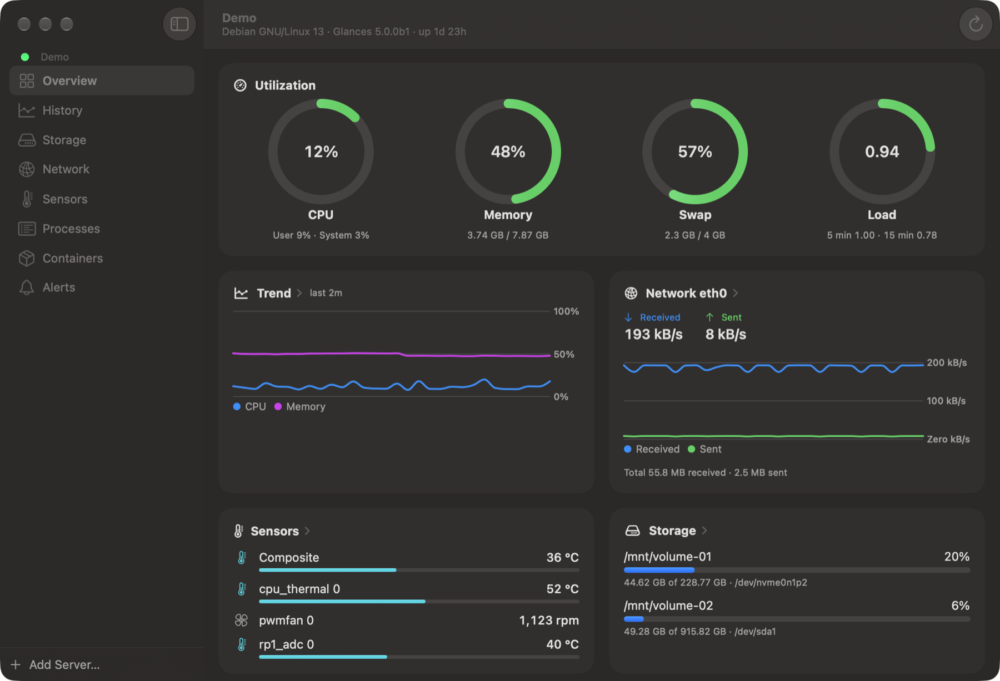
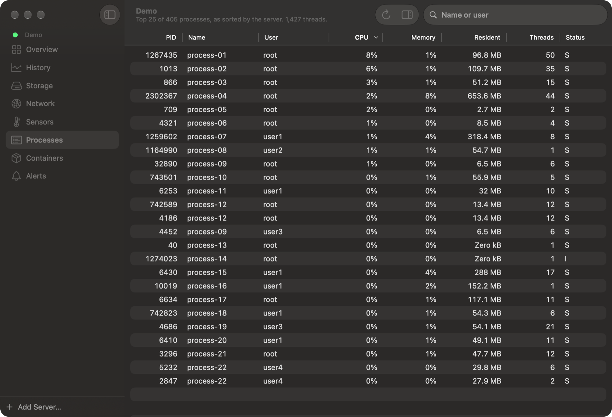

# MetriBar

[](https://github.com/schnabstar/MetriBar/actions/workflows/ci.yml)

**Glances 5 in your macOS menu bar.**

MetriBar is a native macOS menu bar app with a dashboard window for servers running [Glances](https://github.com/nicolargo/glances) 5. See the status of your Raspberry Pi, NAS or Docker host at a glance, and open a native dashboard for the details.

No agent to install, no cloud, no account, no telemetry. An optional update check is off until you turn it on.



> **Status:** MetriBar uses the Glances 5 REST API (`/api/5`), which is currently in beta. Glances 4 is not supported. Expect changes until Glances 5.0 and MetriBar 1.0 are released.

## Features

- **Menu bar:** one icon for the combined status of all servers; its shape changes on warnings, critical values or when a server is offline. Optionally shows the CPU or memory usage of a server.
- **Popover:** CPU, memory, load, uptime and containers of the selected server, with a server switcher. When a server cannot be read, MetriBar explains why and offers the fix.
- **Dashboard window** with the sections of every server in the sidebar (⌘1–⌘8):
  - Overview with usage rings, trend, network, sensors (temperatures, fans), storage, containers, system information and active alerts
  - History charts from the history Glances keeps
  - File systems and disk I/O
  - Network interfaces
  - Sensors and GPU
  - Processes with search, sorting and an inspector; command lines only on request
  - Containers with CPU and memory limits, network, I/O, uptime and ports
  - Glances alerts and incidents
- **Your own thresholds:** rules such as "CPU above 90 % for 5 minutes" or "a disk above 85 %" for one server or all, for CPU, memory, swap, load, disks, temperatures and network throughput, with a hold time and a hysteresis. A rule that fires changes the status icon like a warning from Glances and is reported by notifications. Rules only change what MetriBar shows; nothing changes on your servers.
- **Notifications** (off by default): a macOS notification when a value reaches warning or critical, a container becomes unhealthy, or a server cannot be reached, with a hold time against short spikes, quiet hours and a switch per server. They are created on your Mac; nothing is sent anywhere.
- **Multiple servers**, each polled independently. Only the data that is visible is fetched.
- **Secure by default:** passwords in the Keychain, TLS validation with optional pinning of self-signed certificates, warnings for passwords over plain HTTP, strictly read-only access.
- **Helpful diagnostics:** a step-by-step connection test, detection of a missing local network permission, and copyable diagnostic details without secrets.
- English and German.



The screenshots show the built-in demo data, not a real server.

## Requirements

- macOS 26 or later, on Apple silicon or Intel (the app is universal)
- A server running **Glances 5** as a web server (`glances -s`). See [Setting up Glances 5](Docs/glances-setup.md).

## Installation

1. Download the disk image (`MetriBar-<version>.dmg`) from the [latest release](https://github.com/schnabstar/MetriBar/releases).
2. Open the disk image and drag **MetriBar** to your Applications folder.

The app is signed with a Developer ID and notarized by Apple. Each release also lists a SHA-256 checksum (`MetriBar-<version>.sha256`) if you want to verify the download.

To try MetriBar without a server, choose **Try with Demo Data** after the first launch.

### Updating

MetriBar does not install updates by itself. To update, download the new version from the [releases page](https://github.com/schnabstar/MetriBar/releases) and replace the app in your Applications folder. Your servers and settings are kept; passwords stay in the Keychain.

To be told about new versions, turn on **Check for updates automatically** in Settings › General. MetriBar then asks GitHub once a day whether a newer release exists (GitHub sees your IP address, nothing else is sent) and points it out in the menu bar window. The setting is off by default, and **Check for Updates…** in the app menu checks once on request. You can also watch the repository (*Watch › Custom › Releases*).

You can also [build MetriBar from source](#building-from-source).

## Documentation

- [Setting up Glances 5](Docs/glances-setup.md): Docker and pipx, password, HTTPS, allowed host names
- [Security](Docs/security.md): what MetriBar protects and what the server operator should do
- [Troubleshooting](Docs/troubleshooting.md): connection problems and their fixes
- [Decisions](Docs/decisions.md): technical decisions and findings during development

## Building from source

Requirements: Xcode 26 or later on macOS 26 or later.

```sh
git clone https://github.com/schnabstar/MetriBar.git
cd MetriBar
swift test --package-path Packages/MetriBarKit   # core library tests
open MetriBar.xcodeproj
```

The project signs with the maintainer's team by default. To build and run it yourself, copy `Config/Local.xcconfig.example` to `Config/Local.xcconfig` (ignored by git) and enter your own team ID and bundle identifier.

MetriBar stores passwords in the data protection keychain, which requires a provisioning profile. If your account cannot create one (for example a free Apple ID), the example file shows how to switch your local builds to the file-based keychain.

More in [CONTRIBUTING.md](CONTRIBUTING.md).

## Privacy

MetriBar talks to the Glances servers you add and, only if you turn it on, to GitHub for the update check. It collects no data and has no telemetry. See [PRIVACY.md](PRIVACY.md).

## Contributing

Bug reports, ideas, translations and pull requests are welcome. Please read [CONTRIBUTING.md](CONTRIBUTING.md) and the [Code of Conduct](CODE_OF_CONDUCT.md). Report security issues privately as described in [SECURITY.md](SECURITY.md).

## License

MetriBar is licensed under the [Apache License 2.0](LICENSE).

MetriBar is an independent project and is not affiliated with or endorsed by the Glances project. See [NOTICE](NOTICE).
